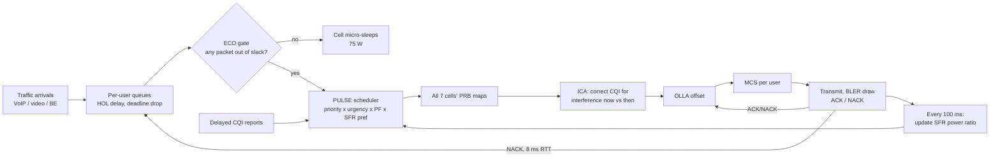

# PULSE-LTE: A QoS-, Interference- and Energy-Aware Radio Resource Manager for LTE

**Subject:** Wireless and Mobile Communications — Project
**Topic:** LTE Network Resource Management System

PULSE = **P**riority-**U**rgency scheduling, **L**ink adaptation that is interference-coordinated, **S**oft frequency reuse that adapts to load, **E**nergy saving through slack-aware cell DTX.

---

## 1. Abstract

LTE assigns radio resources every 1 ms (one TTI) in units of Physical Resource Blocks (PRBs). Classic schedulers optimise one thing at a time: Round Robin optimises fairness, Max C/I optimises throughput, Proportional Fair (PF) balances the two. None of them looks at packet deadlines, at what neighbouring cells are about to do, or at the energy the base station burns while it sits idle.

PULSE is a centralised (C-RAN style) resource manager that makes four coordinated decisions per TTI:

1. **Which user gets each PRB** — a PF metric weighted by traffic class and by how much of each packet's delay budget is already used.
2. **Which MCS to use** — CQI reports are 4 ms old and were measured under different neighbour activity. PULSE corrects each report for the interference that will actually occur this TTI (ICA), then trims residual error with outer-loop link adaptation (OLLA).
3. **How much power each sub-band gets** — soft frequency reuse whose edge/centre power ratio follows the share of cell-edge traffic waiting.
4. **Whether the cell should transmit at all** — packets that still have delay budget are held so the cell can micro-sleep, then served in one burst.

A TTI-level 7-cell LTE downlink simulator (Python) compares PULSE against Round Robin, Max C/I, PF and M-LWDF over identical users, traffic and fading. At low load PULSE cuts base-station power by **39%** and BLER from **45% to 11%** with no throughput loss. Near capacity it raises the share of real-time users meeting their QoS target from **87% to 96%** and cuts video packet loss from **5.2% to 1.0%**. An interactive browser dashboard runs both systems side by side live. The professor can **design their own experiment** (users, speed, traffic mix, CQI delay, fail a tower, drop a jammer), **ask an AI network operator questions in plain English** that it answers by running the experiment, and **anyone in the room can join the network from their own phone** as a live user.

### What sets this project apart

| Most simulator projects | PULSE-LTE |
|---|---|
| One algorithm, shown working | New algorithm measured against 4 standard baselines on identical channels, 3 random drops per point |
| "It works" demo | Ablation study: each of the 4 components' contribution is measured separately |
| Fixed scenario | Examiner sets the conditions: users, speed, traffic mix, CQI delay, tower failures, jammer, stadium surge |
| Presenter drives the demo | Professor and classmates use it: their phones join as users; questions in plain English run real experiments |
| Results in slides | Live A/B: both networks run side by side on the same users, traffic and fading; every run logs to a table and exports as CSV |
| Claims only | Honest trade-offs reported (best-effort throughput drops under overload; PULSE loses QoS at 120 km/h with 8 ms CQI delay) |

---

## 2. Background (what the examiner will expect you to know)

| Concept | Meaning in this project |
|---|---|
| **PRB** | 12 subcarriers × 0.5 ms slot pair = 180 kHz × 1 ms. A 5 MHz carrier has **25 PRBs**. |
| **TTI** | Transmission Time Interval, 1 ms. The scheduler runs once per TTI. |
| **CQI** | Channel Quality Indicator (0–15) reported by the UE. Maps to modulation and code rate (36.213 Table 7.2.3-1). Reported per sub-band of 5 PRBs, with a 4 ms delay here. |
| **MCS / TBS** | Modulation and Coding Scheme chosen by the eNB; with the PRB count it sets the Transport Block Size. |
| **HARQ** | Hybrid ARQ. A failed block (NACK) is retransmitted after an 8 ms round trip. |
| **BLER** | Block Error Rate. LTE link adaptation normally targets 10%. |
| **QCI** | QoS Class Identifier. VoIP ≈ QCI 1 (100 ms budget), live video ≈ QCI 2 (150–300 ms), best effort = QCI 9. |
| **ICIC / SFR** | Inter-Cell Interference Coordination. Soft Frequency Reuse boosts power on a sub-band reserved for cell-edge users and lowers it elsewhere, with neighbours using different sub-bands. |
| **Cell DTX** | Discontinuous transmission: the eNB switches off its power amplifier in TTIs with nothing to send (an LTE-A / 5G NR "lean carrier" idea). |
| **Flashlight effect** | Interference jumps when a neighbour starts or stops transmitting on a PRB, so a CQI measured one moment is wrong the next. |

**Baseline schedulers implemented**

| Scheduler | Metric for user *i* on PRB *k* |
|---|---|
| Round Robin | user served longest ago |
| Max C/I | r<sub>i,k</sub> |
| Proportional Fair | r<sub>i,k</sub> / R̄<sub>i</sub> |
| M-LWDF | a<sub>i</sub> · D<sub>HOL,i</sub> · r<sub>i,k</sub> / R̄<sub>i</sub>, a<sub>i</sub> = −log(δ)/τ<sub>i</sub> |

r = achievable rate from CQI, R̄ = average served rate (100 ms window), D<sub>HOL</sub> = head-of-line delay, τ = delay budget, δ = allowed drop probability.

---

## 3. What is new in PULSE

Each piece below has precedent in the literature on its own (EXP-PF, OLLA, SFR, cell DTX). The contribution here is (a) the **interference-coordinated link adaptation** step, which uses the scheduler's own knowledge of every cell's allocation, and (b) running all four as one control loop and measuring each one's contribution with an ablation study.

### 3.1 Priority-urgency scheduling metric

```
m(i,k) = w_class(i) · U(i) · pref(i,k) · r(i,k) / R̄(i)

w_class = 2.0 (VoIP), 1.5 (video), 1.0 (best effort)
U(i)    = exp( min(4 · D_HOL(i) / τ(i), 6) )   for real-time users, 1 for best effort
pref    = SFR sub-band preference (3.3)
```

A packet with no delay used behaves like PF. As it approaches its deadline its weight rises up to ~55×, so it is served before it would be dropped. Unlike M-LWDF the weight is bounded and grows smoothly, which avoids the large swings M-LWDF shows in video delay at high load.

### 3.2 Interference-coordinated link adaptation (ICA) + OLLA

The UE's CQI was measured 4 ms ago, when the set of interfering PRBs was different. A central controller knows both the allocation at measurement time and the allocation this TTI. UEs already report neighbour-cell RSRP (for handover), which gives the path gain G<sub>u,c</sub> to every cell. So PULSE corrects the reported SINR per PRB:

```
SINR_corrected = SINR_reported · (N + I_then) / (N + I_now)

I_then = Σ_{c ≠ serving} G(u,c) · P_tx(c,k) at the measurement TTI
I_now  = Σ_{c ≠ serving} G(u,c) · P_tx(c,k) this TTI
```

This removes the flashlight error. What remains (fading changes over 4 ms at 30 km/h) is handled by OLLA: a per-user dB offset that moves −0.5 dB on every NACK and +0.056 dB on every ACK, which settles at 10% BLER.

### 3.3 Load-adaptive soft frequency reuse

The 25 PRBs are split into three 8-PRB sub-bands. The centre cell uses sub-band 0 as its edge band; ring cells alternate between 1 and 2, so no two neighbours share an edge band. Every 100 ms each cell sets its edge/centre power ratio:

```
ratio = clip(1 + 5 · edge_share / 0.5, 1, 6)
edge_share = share of the cell's demand (queued + recent rate) belonging to edge users
```

Total transmit power stays at 43 dBm. Edge users (geometry < 3 dB) prefer the boosted sub-band (×1.6), centre users prefer the rest.

### 3.4 Slack-aware cell DTX (ECO)

At low load most of every packet's delay budget is unused. PULSE lets a cell skip a TTI unless:

- a real-time packet has used ≥ 15% of its budget (15 ms for VoIP, 45 ms for video), or
- a best-effort packet has waited ≥ 40 ms, or
- the queued data would fill half a TTI.

When the cell wakes it serves everyone. Sleeping TTIs cost 75 W instead of 130 W (EARTH power model). The 15% figure is a tunable energy-delay knob (Fig. 7).

### 3.5 Control loop



---

## 4. System model

| Parameter | Value |
|---|---|
| Layout | 7 hexagonal cells, 500 m inter-site distance (3GPP urban macro) |
| Users | 15 per cell, uniform drop, strongest-cell association |
| Carrier | 2 GHz, 5 MHz, 25 PRBs |
| eNB power | 43 dBm (20 W), spread evenly over PRBs (or by SFR mask) |
| Path loss | 128.1 + 37.6 log<sub>10</sub>(d km) dB (TR 36.814) |
| Shadowing | log-normal, σ = 8 dB |
| Fast fading | Rayleigh per 5-PRB sub-band, Jakes AR(1), 30 km/h (ρ = 0.97 per ms) |
| Noise | −174 dBm/Hz, 9 dB noise figure |
| CQI | 15-level table (36.213), 4 ms feedback delay |
| Data REs per PRB | 120 (after control and reference signals) |
| BLER model | logistic curve, 10% at the CQI threshold |
| HARQ | 8 ms round trip before retransmission |
| Traffic mix | 30% VoIP (328 bit / 20 ms, 100 ms budget), 30% video (450 kbit/s at 25 fps, 300 ms budget), 40% best effort (Poisson 80 kbit files, 250 kbit/s) |
| Load | video and BE rates × load factor 0.3 … 1.5 |
| Power model | EARTH: P = 130 W + 4.7 · P<sub>RF</sub> when active, 75 W in DTX sleep |
| Run length | 3 s (3000 TTIs) × 3 random drops per point |

All schemes see the same user positions, traffic arrivals and fading (separate random streams), so differences come from the resource manager only.

---

## 5. Results

### 5.1 Headline comparison (Proportional Fair vs PULSE, mean of 3 drops)

| Load | Metric | Prop. Fair | PULSE | Change |
|---|---|---|---|---|
| 0.3× | BLER | 45.0% | 10.8% | −34 pt |
| 0.3× | Power per cell | 165.0 W | 100.9 W | **−39%** |
| 0.3× | Energy efficiency | 6.6 kbit/J | 10.9 kbit/J | **+64%** |
| 0.3× | Video mean delay | 18.3 ms | 7.0 ms | −62% |
| 0.3× | Cell throughput | 1.10 Mbps | 1.10 Mbps | same |
| 0.6× | Power per cell | 204.4 W | 178.3 W | −13% |
| 0.6× | Energy efficiency | 10.3 kbit/J | 11.9 kbit/J | +15% |
| 0.6× | Video mean delay | 22.9 ms | 16.1 ms | −30% |
| 0.9× | RT users meeting QoS | 87.1% | 96.1% | **+9 pt** |
| 0.9× | Video packet loss | 5.2% | 1.0% | −81% |
| 0.9× | Cell throughput | 2.93 Mbps | 2.79 Mbps | −5% |
| 1.2× | RT users meeting QoS | 77.0% | 86.1% | +9 pt |
| 1.2× | Video packet loss | 15.4% | 4.8% | −69% |
| 1.2× | Cell throughput | 3.56 Mbps | 3.21 Mbps | −10% |

### 5.2 Figures (in `results/`)

| Figure | Shows |
|---|---|
| `fig1_qos_satisfaction.png` | Share of VoIP/video users meeting loss targets vs load |
| `fig2_bler.png` | BLER vs load: ICA + OLLA hold ~11% where others sit at 27–45% |
| `fig3_power.png` | Base-station power vs load |
| `fig4_video_plr.png` | Video packet loss vs load |
| `fig5_throughput.png` | Cell throughput vs load (the cost side) |
| `fig6_energy_efficiency.png` | Bits per joule vs load |
| `fig7_energy_delay_tradeoff.png` | Power vs VoIP delay as the DTX slack knob is turned |
| `fig8_cqi_delay_sensitivity.png` | Same PF scheduler with and without ICA + OLLA as CQI feedback delay grows 1–10 ms |
| `fig9_ablation_load0.6.png`, `fig10_ablation_load1.2.png` | Contribution of each PULSE component |

### 5.3 Ablation: what each component does

- **Scheduler alone** (priority-urgency): fixes QoS. At 0.9× load QoS-satisfied users go from 87% to 98% and video loss from 5.2% to 0.3%. It does nothing for BLER or power.
- **ICA** is the most valuable single addition. At 0.3× it halves BLER (43% → 20%), cuts power 10% because fewer retransmissions keep the cell busy for less time, and cuts video delay from 17 ms to 4 ms, with no throughput loss at any load.
- **OLLA** on top of ICA brings BLER to the 10% target and lowers VoIP delay (4.2 → 2.8 ms at 0.3×). Its MCS back-off costs 2–4% throughput at high load. Without ICA, OLLA alone has to absorb the flashlight error and backs off too far (it loses throughput and raises power at 0.3×), which is why ICA comes first.
- **Adaptive SFR** recovers 1–2% throughput and improves edge-user satisfaction at high load.
- **Cell DTX** saves ~18% power at 0.3× just by sleeping in naturally idle TTIs.
- **Slack-aware batching** adds a further 17% saving (121 W → 101 W) at 0.3×. Sleep time rises from 47% to 79% of TTIs. VoIP delay rises from 2.9 ms to 7.4 ms, still under 8% of its 100 ms budget.

### 5.4 Sensitivity studies

**CQI feedback delay (load 0.9×, PF scheduler in both arms).** With plain reported CQI, BLER climbs from 14% at 1 ms delay to 42% at 10 ms. Adding ICA + OLLA keeps BLER between 10% and 13% over the whole range and cuts VoIP delay (5.3 → 3.0 ms at 10 ms feedback delay), at a throughput cost of 1–5%. Link adaptation that knows the real interference is what makes slow feedback tolerable.

**Energy-delay knob (slack share ECO may use).** At 0.3× load, letting real-time packets wait 5% of their budget drops power from 119 W (plain DTX) to 105 W; 15% gives 101 W with VoIP delay 7.5 ms. Beyond 15–25% the curve flattens (99 W), so 15% is the default. At 0.6× the same knob saves 184 → 173 W.

### 5.5 Trade-off and limitations

- **Best-effort pays at overload.** Above ~0.9× the cell cannot carry everything. PULSE deliberately gives real-time traffic priority, so best-effort goodput falls (0.90 → 0.72 of offered at 0.9×; 0.85 → 0.50 at 1.2×) and total throughput drops 5–15%. This is the intended operator policy for a QoS network, but a minimum-rate guard for BE would be a sensible extension.
- **ECO only helps when there is idle time.** Above ~0.9× load the cell is always awake and savings vanish (as they should).
- **Simplifications:** single-antenna downlink (no MIMO), mean-dB effective SINR instead of EESM/MIESM, no HARQ soft combining, static users (fading from speed only), no control-channel (PDCCH) limits, 7-cell cluster without wrap-around, so ring cells see less interference than the centre cell. ICA assumes the controller knows neighbour gains exactly; in practice RSRP reports are quantised and averaged.

---

## 6. Interactive dashboard

`dashboard/index.html` is a self-contained web page (no install). It runs a JavaScript port of the same simulator: two identical networks, Prop. Fair vs PULSE, on the same users and traffic.

- **Network map** — users coloured by class, cell-edge users ringed, cells shaded by PRB utilisation, sleeping cells tinted.
- **Resource grids** — 25 PRBs × last 120 TTIs for the selected cell; failed blocks show in black, sleep TTIs in blue. Tap a cell on the map to inspect it.
- **Controls** — load slider, speed, toggle each PULSE feature on/off live, and a **stadium surge** button that triples traffic in the centre cell.
- **KPI ledger** — throughput, BLER, VoIP delay, video loss, QoS satisfaction, power, sleep share, energy efficiency, with colour-coded change.

### Experiment lab (for the professor)

- **Network setup** (then *Rebuild network*): users per cell 5–25, user speed (3 / 30 / 60 / 120 km/h, which changes how fast fading decorrelates), voice/video/download mix, CQI feedback delay 1–10 ms.
- **Live events** (no rebuild needed): tap the map to fail or restore a tower (its users re-attach to the next strongest cell), or to place a 10 W jammer that hits PRBs 0–11. The jammer is invisible to the central controller, so ICA cannot correct for it and OLLA has to learn it from failed blocks, which is a useful teaching contrast. Stadium surge triples traffic in the centre cell.
- **Experiment log**: *Record current result* adds a row with both networks' KPIs and a scenario label; *Save as CSV* downloads the log.

Examples measured at 0.9× load: with cell 3 failed, PF's video loss rises to 9.9% while PULSE holds 0.2% and keeps 98% of real-time users within target. At 120 km/h with 8 ms CQI delay, PF's BLER reaches 53% versus 19% for PULSE, but PULSE's QoS satisfaction drops below PF's (88% vs 94%): link adaptation cannot keep up with a channel that decorrelates within the feedback delay, and that is a documented limitation.

### Ask the network (AI operator)

A text box where anyone types a question, for example *"Fail cell 3 at 1.2× load. Who suffers more, PF or PULSE users?"*. An AI operator (Claude, running on the viewer's own Claude account) has tools to set the load, fail or restore towers, place the jammer, toggle the surge and each PULSE feature, and run the simulator for a few seconds. It sets up a fair comparison, runs it, restores what it changed, then answers in under 170 words with the measured numbers and the LTE reasoning. Every run it makes appears in the experiment log. The first question asks the viewer's permission to use their account.

### Bring your own phone

The control-room screen shows a QR code and a join link (the page link ending in `#join`). Anyone who opens it on a phone becomes a **real user inside both simulated networks**:

1. Type a name, pick what the phone is doing — **Voice call**, **HD video** (1.2 Mbit/s), **Download** (2 Mbit/s) or **Idle**.
2. Tap the map to choose where you are standing. The phone is placed there, its path loss and shadowing to all 7 cells are computed, and it attaches to the strongest cell.
3. The phone shows, live, its serving cell, whether it is a cell-edge user, SINR, CQI and modulation, and a side-by-side table of **its own** throughput, PRBs per TTI, delay, packet loss and failed blocks under Prop. Fair and under PULSE.
4. On the control-room screen the phone appears as a labelled diamond on the map, its PRBs show in the resource grid, and a table lists every connected phone.

Example from testing: a phone standing at a cell edge (SINR ≈ −3 dB) streaming HD video loses 59% of its packets under Prop. Fair and 31% under PULSE; standing next to the tower, both schedulers give it full rate on 64QAM.

How it works: phones publish their name, service and position through the page's live room channel; the control-room screen adds them to reserved user slots (up to 12 phones), simulates them like any other user, and broadcasts each phone's measurements twice a second. Two ways to run it: from your laptop with `serve.py` (anyone on the same Wi-Fi/hotspot joins, no account; see section 7), or inside Claude (phones must be signed in to Claude and the page shared with them). Either way the control-room screen must stay open.

Note: a web page cannot read a phone's real LTE radio measurements (RSRP, CQI). The phone is a real participant placed in the simulated radio environment, not a measurement of its actual cellular signal.

### Demo script for the viva

 start at load 0.6 → point at black NACK cells on the PF grid vs PULSE → switch ICA off and watch PULSE's BLER climb → slide load to 0.3 and show blue sleep bands and the power gap → press stadium surge and show video loss rising on PF but not PULSE → ask two classmates to scan the QR, one stands next to a tower, one at the cell edge on HD video, and compare their phones.

---

## 7. Run the live demo from your laptop (no Claude account needed)

Use this in class. Phones need no account, no app and no internet.

1. Install Python 3.8 or newer on the laptop (nothing else; `serve.py` uses only the standard library).
2. Turn on your phone's hotspot, or use the classroom Wi-Fi, and connect the laptop to it.
3. In the `pulse-lte` folder run:
   ```bash
   python serve.py
   ```
   The dashboard opens in the laptop's browser. Put it on the projector.
4. Everyone connects their phone to the **same** Wi-Fi/hotspot and scans the QR code on the dashboard (or types the address printed in the terminal, e.g. `http://192.168.43.12:8000/#join`).
5. Press Ctrl+C in the terminal to stop.

If phones can't connect:
- **Windows:** click *Allow access* when the firewall asks (tick Private networks). If you missed it, allow Python in Windows Defender Firewall settings.
- **Wrong address in the QR code:** the laptop may have several network adapters. The terminal lists the alternatives; restart with the right one: `python serve.py --ip 192.168.43.12`.
- **Port in use:** `python serve.py --port 9000`.
- Some college Wi-Fi networks block phone-to-laptop traffic ("client isolation"). Use a phone hotspot instead.

In laptop mode everything works except the AI operator, which needs Claude. The experiment log's *Save as CSV* downloads directly in the browser.

## 8. Code layout and how to run

```
pulse-lte/
├── pulse/
│   ├── config.py        all parameters + feature toggles
│   ├── phy.py           CQI table, SINR→CQI→efficiency, BLER curve
│   ├── schedulers.py    RR, Max C/I, PF, M-LWDF, PULSE
│   └── simulator.py     topology, channel, traffic, HARQ, ICA, OLLA, SFR, energy, metrics
├── experiments.py       11 schemes × 5 loads × 3 drops → results/summary.csv
├── sensitivity.py       energy-delay knob and CQI-delay studies
├── plots.py             all figures
├── quick_check.py       one-screen comparison (≈1 min)
├── serve.py             classroom server with REST APIs: /api/simulate, /api/compare, /api/schemes, /api/summary
├── dashboard/index.html modern dark navy telecom NOC dashboard with 5-scheduler comparison & educational guide
├── dashboard/vendor/    QR-code library bundled for offline use (MIT)
├── tests/               automated unit test suite (simulation engine, schedulers, and server APIs)
└── results/             CSVs and PNG figures
```

### Running the Project

```bash
# 1. Install dependencies
pip install -r requirements.txt

# 2. Run the automated unit test suite
python -m unittest discover -s tests -p "test_*.py"

# 3. Launch the modern telecom NOC dashboard server
python serve.py
# -> Open http://localhost:8000 on your laptop / projector
# -> Students/professors can scan the on-screen QR code to join live via Wi-Fi

# 4. Command-line simulation experiments
python quick_check.py              # fast side-by-side verification table
python experiments.py              # full sweep across loads [0.3, 0.6, 0.9, 1.2, 1.5]
python sensitivity.py              # energy-delay and CQI feedback delay sensitivity
python plots.py                    # generate publication figures in results/
```

Single run in Python:

```python
from pulse import SimConfig, LTESimulator
cfg = SimConfig(scheduler="pulse", ica=True, olla=True, sfr=True, energy=True, load_scale=0.6)
print(LTESimulator(cfg).run())
```

---

## 8.1 Model Assumptions and Limitations

> [!NOTE]
> **Academic Disclosure:** This project is a software-based discrete-time (1 TTI = 1 ms) simulation of an LTE downlink cellular network, implemented according to 3GPP specifications for academic research and educational evaluation. It is not connected to physical cellular base station hardware or live spectrum.

1. **Cell Layout & Propagation:**
   - 7-cell hexagonal cluster with inter-site distance (ISD) of 500 m (3GPP urban macro scenario TR 36.814).
   - Distance-dependent macro pathloss: `PL = 128.1 + 37.6 * log10(d_km)`.
   - Log-normal shadow fading standard deviation: 8 dB.
   - Small-scale Rayleigh fading per CQI sub-band follows Jakes/Clarke spectrum with AR(1) temporal correlation based on UE mobility speed (default 30 km/h).
2. **Radio Resource Partitioning:**
   - 5 MHz channel bandwidth yielding 25 Physical Resource Blocks (PRBs).
   - Single-Input Single-Output (SISO) antenna configuration.
   - 120 user data Resource Elements (REs) per PRB per TTI after control channel (PDCCH) and reference signal (CRS) overhead.
3. **Traffic & Queue Dynamics:**
   - VoIP: 328-bit AMR 12.2 kbps packet every 20 ms with 100 ms hard delay deadline (QCI 1).
   - Video: log-normally distributed frame arrivals every 40 ms (25 fps, 450 kbps mean) with 300 ms deadline (QCI 2).
   - Best-Effort: Poisson burst arrivals with exponentially distributed file sizes (80 kbit mean).
4. **Energy Model:**
   - Base station power follows the EARTH consortium macro power model: $P_{active} = 130\text{ W} + 4.7 \times 20\text{ W} \times \frac{\text{PRBs}_{tx}}{25}$ and $P_{sleep} = 75\text{ W}$ in micro-sleep DTX.
5. **BYOD Mobile Device Mode:**
   - Web browsers cannot directly measure physical cellular RSRP/CQI hardware registers due to operating system sandboxing. When devices join via the QR code (`#join`), their selected location and traffic class drive a simulated UE experiencing the exact 3GPP propagation models.

---

## 9. Viva questions you should be ready for

**Why not just use Proportional Fair?** PF ignores deadlines. At 0.9× load it drops 5% of video packets because a video user with a poor channel waits too long. PULSE's urgency term serves that packet before its deadline.

**How is PULSE different from M-LWDF or EXP-PF?** The scheduling metric is in the same family. The differences are the bounded exponential urgency, the SFR preference term, and that scheduling is only one of four coordinated decisions. Our M-LWDF result shows video delay rising to 147 ms at 1.5× load while PULSE trades best-effort throughput instead.

**Is ICA realistic?** It needs a central view of all cells' allocations in the same TTI (C-RAN / O-RAN near-real-time RIC with tight fronthaul) and neighbour gains, which UEs already measure as RSRP for handover. In a distributed eNB deployment the same idea can work with X2-signalled allocation plans one TTI ahead.

**Why does OLLA reduce throughput at high load?** It lowers the MCS to hit 10% BLER. Each block carries fewer bits but fails less. With an 8 ms HARQ round trip, fewer failures mean lower delay, so it is a latency-for-throughput trade.

**Does DTX break LTE?** Release-8 LTE sends cell-specific reference signals in every subframe, so full DTX needs MBSFN subframes (up to 6 of 10) or the lean-carrier design of LTE-A / 5G NR. The model assumes an NR-style lean carrier.

**What does the 15% slack knob control?** How much of each real-time packet's delay budget the cell may spend waiting so traffic can be batched. Fig. 7 shows the curve; at 0.3× load moving from 0% to 15% saves about 18 W per cell for ~5 ms of extra VoIP delay.

**Is the phone really measuring LTE?** No. Browsers cannot read radio measurements. The phone is a participant whose position and traffic choice drive a simulated user; the radio channel it experiences comes from the same path-loss, shadowing and fading model as everyone else. Reading real RSRP/RSRQ would need a native Android app (TelephonyManager CellInfoLte), listed under future work.

**Why are the throughputs only ~3 Mbps per cell?** 5 MHz, single antenna, 7-cell interference-limited layout and ~55% of the load is low-rate real-time traffic. Spectral efficiency is ~0.7–0.9 bit/s/Hz, in line with 3GPP SISO macro results.

**How do you know the comparison is fair?** Every scheme runs on the same user drop, same packet arrivals and same fading samples (separate random streams per process), averaged over 3 drops.

---

## 10. Future work

- Minimum-rate guarantee for best-effort users under overload.
- Learned urgency and DTX thresholds (contextual bandit or deep RL) instead of fixed constants.
- MIMO and carrier aggregation, EESM effective SINR, HARQ chase combining.
- Uplink scheduling with power control.
- Feed real phone measurements (RSRP, RSRQ, CQI from an Android app) into the simulator as the joining user's channel.
- Extend to 5G NR numerologies and network slicing (one PULSE weight vector per slice).

---

## 11. References

1. 3GPP TS 36.213, *E-UTRA Physical layer procedures* — CQI table, link adaptation.
2. 3GPP TR 36.814, *Further advancements for E-UTRA physical layer aspects* — path loss and simulation assumptions.
3. F. Capozzi, G. Piro, L. A. Grieco, G. Boggia, P. Camarda, "Downlink packet scheduling in LTE cellular networks: Key design issues and a survey," *IEEE Communications Surveys & Tutorials*, 2013.
4. M. Andrews, K. Kumaran, K. Ramanan, A. Stolyar, P. Whiting, R. Vijayakumar, "Providing quality of service over a shared wireless link" (M-LWDF), *IEEE Communications Magazine*, 2001.
5. K. I. Pedersen, G. Monghal, I. Z. Kovács, T. E. Kolding, A. Pokhariyal, F. Frederiksen, P. Mogensen, "Frequency domain scheduling for OFDMA with limited and noisy channel feedback" (OLLA), *IEEE VTC Fall*, 2007.
6. Huawei, R1-050507, "Soft frequency reuse scheme for UTRAN LTE," 3GPP TSG RAN WG1, 2005.
7. G. Auer et al., "How much energy is needed to run a wireless network?" (EARTH power model), *IEEE Wireless Communications*, 2011.
8. P. Frenger, P. Moberg, J. Malmodin, Y. Jading, I. Gódor, "Reducing energy consumption in LTE with cell DTX," *IEEE VTC Spring*, 2011.
